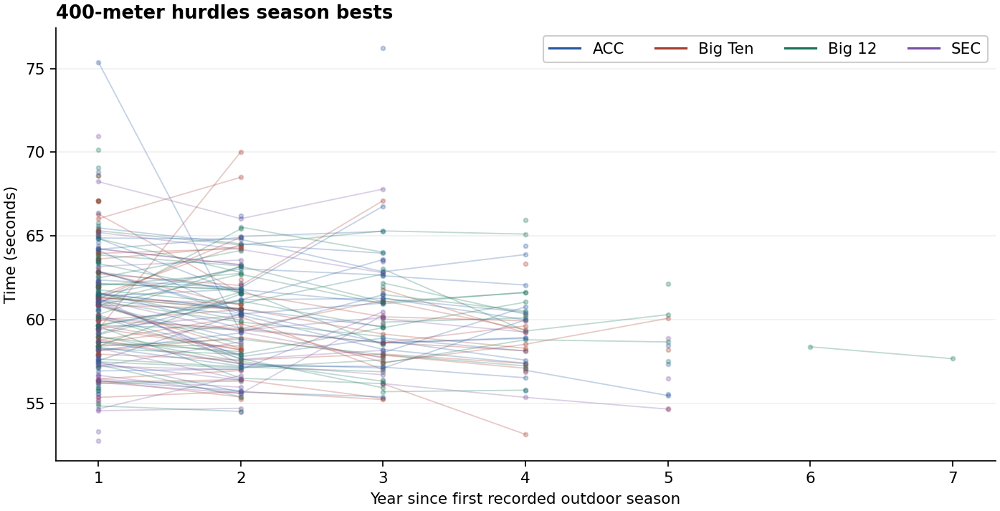
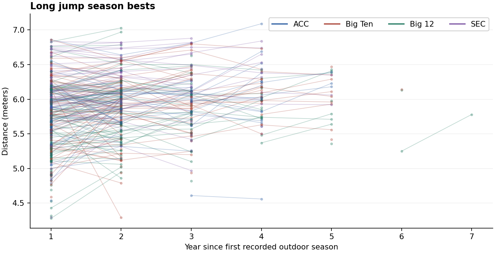

# College Track Performances

We examined how women's outdoor college track and field performances changed across athletes' years in college and whether season-best performances differed by outdoor eligibility year. We collected available results from 2016 through 2026 for the 100-meter hurdles (100H), 400-meter hurdles (400H), 400 meters (400m), and long jump.

## Data and school selection

We sampled five schools from each of four conferences: the ACC, Big Ten, Big 12, and SEC. The conferences gave us a way to identify schools and capture performances from some of the top athletes in the four events. Our analysis focuses on how athletes progressed across their college years. The sample was limited to 20 schools, so programs such as Michigan, Wisconsin, and Texas fell outside its scope. The project records do not document a school-by-school ranking or the reasons for selecting particular programs over others. Conference labels follow the project's school assignments, which can differ from historical conference membership.

| Conference | Selected schools | Annual file |
| --- | --- | --- |
| ACC | Clemson, Duke, Florida State, Stanford, Virginia | `data/processed/acc_YYYY.csv` |
| Big Ten | Illinois, Nebraska, Oregon, USC, Washington | `data/processed/bigten_YYYY.csv` |
| Big 12 | Arizona, Baylor, BYU, Iowa State, Texas Tech | `data/processed/big12_YYYY.csv` |
| SEC | Alabama, Florida, Georgia, Kentucky, South Carolina | `data/processed/sec_YYYY.csv` |

We used the Track & Field Results Reporting System (TFRRS) to look up performances by school, season, and event. When available, we recorded the athlete's name, school, meet, date, performance, class year, and wind reading. The [raw files](data/raw/) contain school-by-year results where available. The [processed files](data/processed/) combine results by conference and year and include the [ACC audit](data/processed/acc_2016_2026_audit.csv) and [SEC audit](data/processed/sec_2016_2026_audit.csv). We kept older sourced ACC and SEC records that we could not match to the listings and flagged them for review.

We excluded entries without a valid mark, such as unfinished races and foul jumps. We checked known name variations and transfers to connect results across seasons. For each athlete, event, and outdoor season, we selected the fastest recorded race time or the longest recorded jump. These season bests depend on the results available in our files.

School transfers and changes in name spelling made some athletes' records harder to match. Outdoor eligibility year can differ from the class year reported in the source. The 100H model data received a more detailed review, and all four event models excluded cases where athlete identity or eligibility year could not be resolved. Some records lack wind readings or round information. We kept wind-assisted marks in the main analysis and used a sensitivity check to see how unusual marks, including a 32.80-second 100H result, affected the models. Coverage is especially limited in 2020, when the ACC, Big 12, and SEC annual files contain no results and the Big Ten file contains four rows. The 2026 files reflect the results available at the time of collection.

## Season-best summaries and plots

Each count represents one athlete's best recorded mark in one event and season. We used the class and conference attached to the selected mark. An athlete can contribute to the table in multiple seasons or events. The descriptive summaries include valid marks from flagged older records, and 22 marks have an unknown class year.

| Conference | First-year | Sophomore | Junior | Senior | Unknown | Total |
| --- | ---: | ---: | ---: | ---: | ---: | ---: |
| ACC | 199 | 201 | 185 | 171 | 4 | 760 |
| Big Ten | 229 | 227 | 174 | 151 | 10 | 791 |
| Big 12 | 285 | 204 | 219 | 173 | 8 | 889 |
| SEC | 210 | 145 | 164 | 122 | 0 | 641 |
| **Total** | **923** | **777** | **742** | **617** | **22** | **3,081** |

| Reported class | 100H (s) | 400H (s) | 400m (s) | Long jump (m) |
| --- | ---: | ---: | ---: | ---: |
| First-year | 14.24 | 61.53 | 56.05 | 5.71 |
| Sophomore | 14.00 | 60.52 | 55.33 | 5.85 |
| Junior | 13.90 | 59.83 | 54.82 | 5.94 |
| Senior | 13.70 | 58.96 | 54.65 | 6.00 |

The average season best was faster in each successive reported class for all three running events. In long jump, the average rose from 5.71 meters for first-year athletes to 6.00 meters for seniors. The athletes represented in each class can differ, so these averages describe the marks we collected for each class. The plots below show how individual athletes' season bests changed.

Each dot shows one season best. Year 1 is the earliest outdoor season we recorded for that athlete across the four events. Lines connect consecutive seasons in the same event, and gaps show seasons without a recorded mark for that event. An athlete keeps the color of the conference attached to their first plotted mark in that event. Downward lines show faster running times, and upward lines show longer jumps. The 100H plot displays 12–17 seconds. Four season bests fall outside that range and are included in the tables.

The analysis uses the [100H](data/processed/by_event/100H_2016_2026.csv), [400H](data/processed/by_event/400H_2016_2026.csv), [400m](data/processed/by_event/400m_2016_2026.csv), and [long jump](data/processed/by_event/long_jump_2016_2026.csv) files. We use athlete, event, and season to identify each season best. School, conference, and reported class describe the records. In the [regression notebook](All_events_regression_model_checks-2-2.ipynb), the outcome is season-best time or distance, modeled on both the original and log scales. Outdoor eligibility year is the predictor, and athlete identity accounts for repeated observations of the same athlete.

## Appendix

| Other fields | What they show |
| --- | --- |
| `unit`, `indoor_outdoor` | Unit of measurement and competition setting |
| `meet`, `meet_date`, `round`, `place`, `wind` | Competition details, when available |
| `birth_date`, `age_at_meet` | Birth date and age, when reliably sourced |
| `source_url`, `data_status` | Source link and review status |

The [scripts folder](scripts/) contains the ACC and SEC annual build scripts and legacy audit scripts. To rebuild a season, run the corresponding build script with the year, for example `python scripts/build_sec_all_meets.py 2024`. Then run the matching legacy audit script to restore and flag older unmatched records. The audit scripts use earlier Git commits and may require the full repository history.
