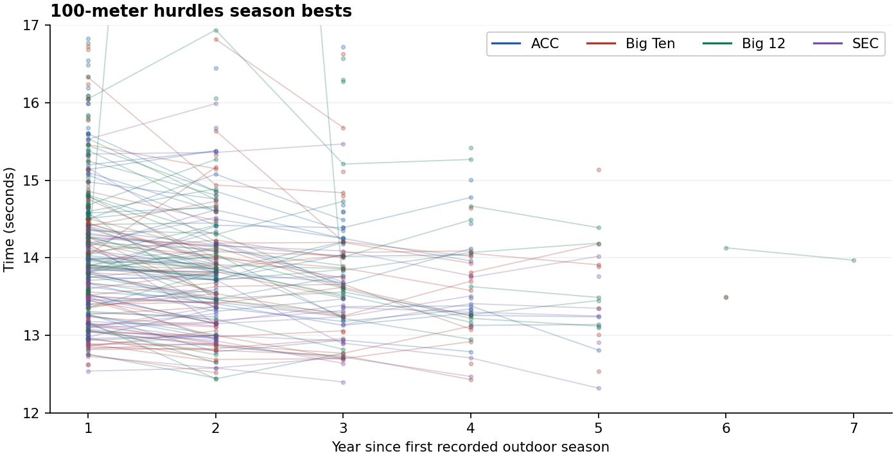
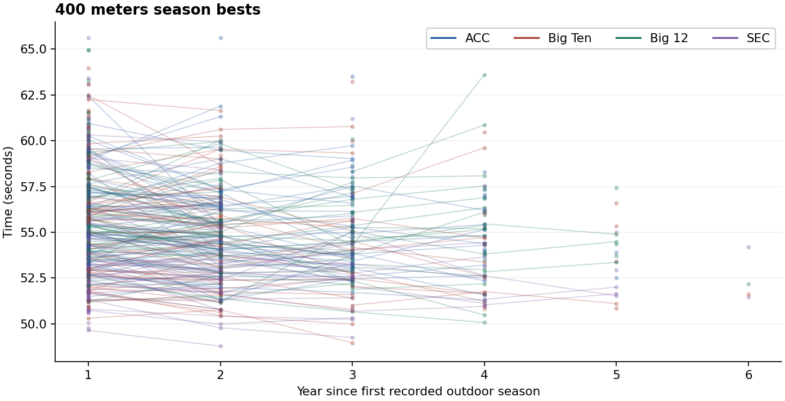
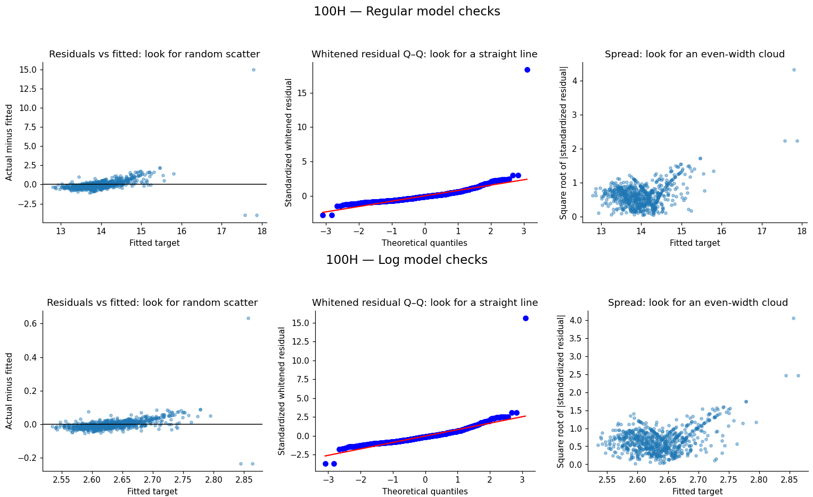
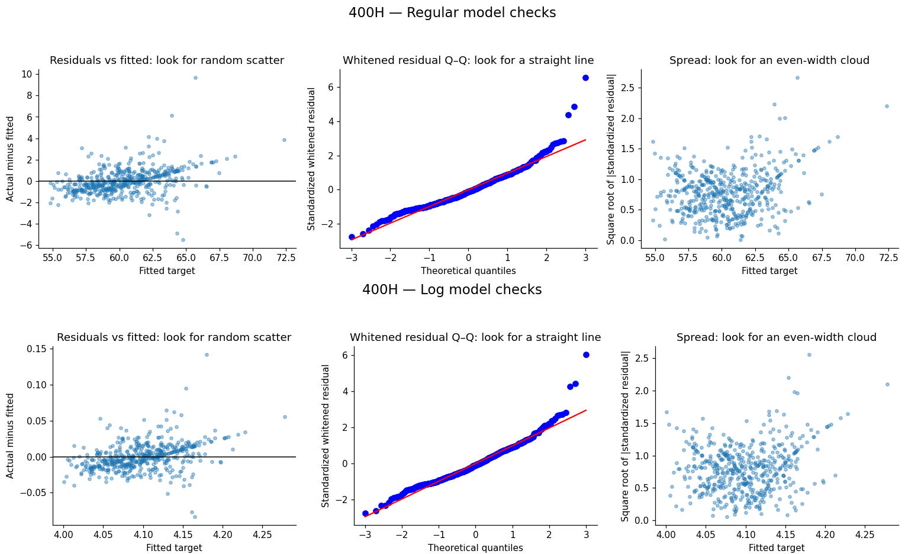
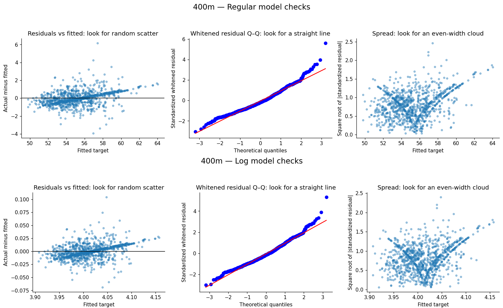
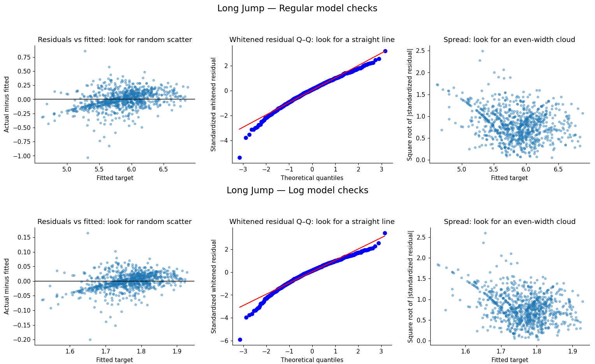

# College Track Performances

We examined how women's outdoor college track and field performances changed across athletes' years in college and whether season-best performances differed by outdoor eligibility year. We collected available results from 2016 through 2026 for the 100-meter hurdles (100H), 400-meter hurdles (400H), 400 meters (400m), and long jump.

## Data and school selection

We sampled five schools from each of four conferences: the ACC, Big Ten, Big 12, and SEC. The conferences gave us a way to identify schools and capture performances from some of the top athletes in the four events. Our analysis focuses on how athletes progressed across their college years. The sample was limited to 20 schools, so programs such as Michigan, Wisconsin, and Texas fell outside its scope. The project records do not document a school-by-school ranking or the reasons for selecting particular programs over others. Conference labels follow the project's school assignments, which can differ from historical conference membership.

| Conference | Selected schools | Annual file |
| --- | --- | --- |
| ACC | Clemson, Duke, Florida State, Stanford, Virginia | `data/processed/acc_YYYY.csv` |
| Big Ten | Illinois, Nebraska, Oregon, USC, Washington | `data/processed/bigten_YYYY.csv` |
| Big 12 | Arizona, Baylor, BYU, Iowa State, Texas Tech | `data/processed/big12_YYYY.csv` |
| SEC | Alabama, Florida, Georgia, Kentucky, South Carolina | `data/processed/sec_YYYY.csv` |

We used the Track & Field Results Reporting System (TFRRS) to look up performances by school, season, and event. When available, we recorded the athlete's name, school, meet, date, performance, class year, and wind reading. The [raw files](data/raw/) contain school-by-year results where available. The [processed files](data/processed/) combine results by conference and year and include the [ACC audit](data/processed/acc_2016_2026_audit.csv) and [SEC audit](data/processed/sec_2016_2026_audit.csv). We kept older sourced ACC and SEC records that we could not match to the listings and flagged them for review.

We excluded entries without a valid mark, such as unfinished races and foul jumps. We checked known name variations and transfers to connect results across seasons. For each athlete, event, and outdoor season, we selected the fastest recorded race time or the longest recorded jump. These season bests depend on the results available in our files.

School transfers and changes in name spelling made some athletes' records harder to match. Outdoor eligibility year can differ from the class year reported in the source. The 100H model data received a more detailed review, and all four event models excluded cases where athlete identity or eligibility year could not be resolved. Some records lack wind readings or round information. We kept wind-assisted marks in the main analysis and used a sensitivity check to see how unusual marks, including a 32.80-second 100H result, affected the models. Coverage is especially limited in 2020, when the ACC, Big 12, and SEC annual files contain no results and the Big Ten file contains four rows. The 2026 files reflect the results available at the time of collection.

## Season-best summaries and plots

Each count represents one athlete's best recorded mark in one event and season. We used the class and conference attached to the selected mark. An athlete can contribute to the table in multiple seasons or events. The descriptive summaries include valid marks from flagged older records, and 22 marks have an unknown class year.

| Conference | First-year | Sophomore | Junior | Senior | Unknown | Total |
| --- | ---: | ---: | ---: | ---: | ---: | ---: |
| ACC | 199 | 201 | 185 | 171 | 4 | 760 |
| Big Ten | 229 | 227 | 174 | 151 | 10 | 791 |
| Big 12 | 285 | 204 | 219 | 173 | 8 | 889 |
| SEC | 210 | 145 | 164 | 122 | 0 | 641 |
| **Total** | **923** | **777** | **742** | **617** | **22** | **3,081** |

| Reported class | 100H (s) | 400H (s) | 400m (s) | Long jump (m) |
| --- | ---: | ---: | ---: | ---: |
| First-year | 14.24 | 61.53 | 56.05 | 5.71 |
| Sophomore | 14.00 | 60.52 | 55.33 | 5.85 |
| Junior | 13.90 | 59.83 | 54.82 | 5.94 |
| Senior | 13.70 | 58.96 | 54.65 | 6.00 |

The average season best was faster in each successive reported class for all three running events. In long jump, the average rose from 5.71 meters for first-year athletes to 6.00 meters for seniors. The athletes represented in each class can differ, so these averages describe the marks we collected for each class. The plots below show how individual athletes' season bests changed.

Each dot shows one season best. Year 1 is the earliest outdoor season we recorded for that athlete across the four events. Lines connect consecutive seasons in the same event, and gaps show seasons without a recorded mark for that event. An athlete keeps the color of the conference attached to their first plotted mark in that event. Downward lines show faster running times, and upward lines show longer jumps. The 100H plot displays 12–17 seconds. Four season bests fall outside that range and are included in the tables.







The analysis uses the [100H](data/processed/by_event/100H_2016_2026.csv), [400H](data/processed/by_event/400H_2016_2026.csv), [400m](data/processed/by_event/400m_2016_2026.csv), and [long jump](data/processed/by_event/long_jump_2016_2026.csv) files. We use athlete, event, and season to identify each season best. School, conference, and reported class describe the records. In the [regression notebook](All_events_regression_model_checks-2-2.ipynb), the outcome is season-best time or distance, modeled on both the original and log scales. Outdoor eligibility year is the predictor, and athlete identity accounts for repeated observations of the same athlete.

## Methods

We fit the models separately for each event. Each model observation was an athlete’s best recorded performance in one outdoor season. For the running events, that was the fastest valid time in seconds. For long jump, it was the longest valid distance in meters. We used the 705 reviewed athlete-season results for the 100-meter hurdles. The other event samples contained 501 athlete-seasons for the 400-meter hurdles, 984 for the 400 meters, and 861 for long jump. We reused reviewed athlete identities and eligibility years where available. For the other records, we used the reported year when it was usable and excluded athlete-seasons where the eligibility year could not be resolved. The results for those events are preliminary because the remaining name matches and eligibility years have not all been verified against rosters.

We used outdoor eligibility year as a categorical predictor, with first-year eligibility as the reference. Each regression estimated a separate difference for Years 2, 3, and 4 compared with Year 1. This let the size of the difference vary by year. Each regression also included an athlete-specific random intercept, which lets athletes have different underlying performance levels and accounts for observations from the same athlete being related. We used a common set of eligibility-year differences within each event. The models did not estimate a separate progression for each athlete or adjust for school, conference, wind, or calendar season.

| Approach | How it works | What it tells us |
| --- | --- | --- |
| Original-scale mixed-effects regression | Fits season-best time in seconds or distance in meters. The year indicators and athlete random intercept are added directly on that scale. | Each year coefficient is the estimated difference from Year 1 in seconds or meters. For example, −0.55 seconds means a faster time in a running event. |
| Log-scale mixed-effects regression | Fits the natural logarithm of the same season best with the same year indicators and athlete random intercept. We convert a year coefficient `b` to a percent difference using `100 × (exp(b) − 1)`. | The year coefficients describe proportional differences. For example, −3.61% in a running event means the estimated time is 3.61% lower. |

Both models used maximum likelihood to estimate the eligibility-year coefficients, between-athlete variance, and residual variance. In the equation below, the response is either the season best or its natural logarithm. Each year indicator is 1 for its named year and 0 otherwise.

```text
response = intercept + b2 × Year2 + b3 × Year3 + b4 × Year4
           + athlete random intercept + residual
```

The intercept describes Year 1 on the fitted scale for an athlete with a random intercept of zero. An athlete’s estimated adjustment is shared across their seasons. Athletes with fewer observations generally have adjustments closer to zero because the model has less information about their usual level. In the log model, the residual is the log of the ratio of the observed mark to the exponentiated fitted value. A log residual of zero means those values agree. We exponentiated the year contrasts to interpret them as percent differences in time or distance, and exponentiated the ends of the log-scale confidence intervals before converting them to percentages.

### Three model diagnostics

A fitted value is what the model estimates for a season best in the data used to fit it. Here the estimate includes the athlete’s random intercept. A residual is the actual result minus that fitted value. If the model fits a hurdle time of 14.00 seconds and the athlete ran 14.45 seconds, the residual is +0.45 seconds. For running, positive residuals mean slower times than fitted. For long jump, positive residuals mean farther jumps than fitted. Negative residuals reverse those interpretations. Original-scale residuals are measured in seconds or meters. Log-scale residuals are measured in log units.

| Diagnostic | What the axes show | How we interpreted it |
| --- | --- | --- |
| **Residuals versus fitted** | Fitted values on the horizontal axis and signed residuals on the vertical axis, both on the model’s scale. | We looked for a cloud centered around zero across the fitted range. A curve or shift suggests the model tends to fit too high or too low in part of that range. Isolated points show specific marks that differed sharply from their fitted values. |
| **Whitened residual Q–Q plot** | Theoretical normal quantiles on the horizontal axis and ordered standardized whitened residuals on the vertical axis. Whitening adjusts for the within-athlete covariance estimated by the model. | Points near the reference line support the model’s normal-error approximation. Bending upward at the right end indicates unusually large positive residuals. A drop at the left end indicates unusually large negative residuals. The tails matter even when the middle looks straight. |
| **Spread versus fitted** | Fitted values on the horizontal axis and the square root of the absolute standardized conditional residual on the vertical axis. Taking the absolute value puts above- and below-fit errors on the same scale. | We looked for similar vertical spread across the fitted range. A widening cloud or a concentration of high points in one part of the plot suggests errors are larger for some fitted performances. We examined the overall cloud and any isolated large errors. |

The residuals-versus-fitted and spread plots both use conditional residuals, which subtract the fit that includes the athlete adjustment. The spread plot standardizes each of those residuals by its estimated standard deviation before applying the square-root transformation. A standardized residual with magnitude 4, for example, appears at height 2 in the spread plot. The Q–Q plot starts with the residuals around the overall eligibility-year fit, then uses the model’s estimated covariance to adjust for the dependence between seasons from the same athlete. It also scales the adjusted residuals before comparing them with normal quantiles. The two types of standardized residuals therefore answer different questions. The Q–Q correlation describes overall alignment and can be close to 1 even when individual points in a tail depart from the line.

The full-sample models include unusual recorded performances. To see how those marks affected the results, we flagged athlete-seasons with an absolute standardized conditional residual above 3 in either regression. We removed that same set of flagged records from both regressions for a single sensitivity refit. This lets us compare the two model scales using the same records.

## Results

### Estimated differences by outdoor eligibility year

Each cell compares the listed eligibility year with Year 1. Negative values mean lower, faster times in the running events. Positive values mean longer jumps. The last column shows the approximate 95% confidence interval for the Year 4 difference from Year 1.

| Event | Regression | Year 2 vs. 1 | Year 3 vs. 1 | Year 4 vs. 1 | Approx. 95% interval for Year 4 |
| --- | --- | ---: | ---: | ---: | ---: |
| 100m hurdles | Original scale | −0.254 s | −0.335 s | −0.552 s | −0.768 to −0.336 s |
| 100m hurdles | Log scale | −1.66% | −2.40% | −3.61% | −4.73% to −2.46% |
| 400m hurdles | Original scale | −0.929 s | −1.327 s | −1.805 s | −2.354 to −1.256 s |
| 400m hurdles | Log scale | −1.49% | −2.17% | −2.92% | −3.77% to −2.06% |
| 400 meters | Original scale | −0.600 s | −0.832 s | −0.833 s | −1.130 to −0.536 s |
| 400 meters | Log scale | −1.06% | −1.49% | −1.52% | −2.04% to −1.00% |
| Long jump | Original scale | +0.097 m | +0.169 m | +0.211 m | +0.155 to +0.268 m |
| Long jump | Log scale | +1.77% | +3.04% | +3.70% | +2.67% to +4.75% |

Both regressions estimated better season bests in Year 4 than in Year 1 for each event. In the hurdles, the fitted differences grew across the eligibility-year categories. In the 400 meters, Years 3 and 4 had almost the same estimated difference from Year 1, so most of the modeled difference appeared by Year 3. In long jump, the original-scale model estimated a Year 4 advantage of about 21 centimeters. These are average associations in the observed athletes. Individual progression can vary, and the models do not identify the cause of the differences.

### What the three diagnostics showed

The table pairs two numerical checks with the plots. A Q–Q correlation closer to 1 indicates that the whitened residual points followed a straighter line overall. The largest absolute standardized conditional residual identifies the most extreme error in the residuals-versus-fitted and spread plots. These summaries help compare the fits alongside the shape and tails of the plots.

| Event | Q–Q correlation, original | Q–Q correlation, log | Largest absolute standardized conditional residual, original | Largest absolute standardized conditional residual, log |
| --- | ---: | ---: | ---: | ---: |
| 100-meter hurdles | 0.7735 | 0.8484 | 18.83 | 16.50 |
| 400-meter hurdles | 0.9674 | 0.9768 | 7.13 | 6.56 |
| 400 meters | 0.9853 | 0.9898 | 6.08 | 5.77 |
| Long jump | 0.9903 | 0.9814 | 6.24 | 6.80 |

#### 100-meter hurdles



- **Residuals versus fitted.** On the original scale, the 32.80-second mark was about 15 seconds slower than its fitted time of roughly 17.8 seconds. Most of the other residuals occupy a much narrower band around zero. Two large negative residuals for the same athlete appear among the slowest fitted times, where the model fitted slower times than the athlete actually ran. Both the positive and negative extremes remain visible on the log scale.
- **Whitened residual Q–Q plot.** Both upper tails bend above the line, with one point far above even the next-largest residuals. The Q–Q correlation rose from 0.7735 to 0.8484 on the log scale. This was the largest improvement from logging across the four events, and both correlations were still the lowest of the four events on their respective scales.
- **Spread versus fitted.** The fastest and most densely populated fitted times mostly have small standardized errors. The highest points appear toward the slower end, including the unusually slow mark and the large errors in the opposite direction. The log transformation reduced the maximum standardized residual magnitude from 18.83 to 16.50. The concentration of high points at slower fitted times remained.

#### 400-meter hurdles



- **Residuals versus fitted.** Both scales show a dense band around zero with large residuals on either side. In the original-scale fit, the 75.38-second mark was about 9.70 seconds slower than fitted. The size and sign of that miss indicate that the model gave an overly fast fitted time for that observation.
- **Whitened residual Q–Q plot.** The middle points track the line more closely than the upper tail. Several of the largest positive residuals rise above the line on both scales. Logging brought the overall correlation from 0.9674 to 0.9768, and the right tail remained visible.
- **Spread versus fitted.** Most of the points lie in a lower band, with scattered large errors around the center and at slower fitted times. The largest standardized residual decreased from 7.13 to 6.56 under the log model. The isolated high points show that the largest errors persisted even with the change in scale.

#### 400 meters



- **Residuals versus fitted.** Both fits have a dense cloud near zero with a slight upward pattern across the fitted range. The positive points toward the slower end represent marks slower than fitted. Some of the biggest misses also occur within the main fitted range.
- **Whitened residual Q–Q plot.** The middle of both plots follows the reference line closely. The upper tail rises above it, with the departure slightly smaller on the log scale. Overall Q–Q correlation increased from 0.9853 to 0.9898.
- **Spread versus fitted.** Both scales show isolated high points and a rising band on the slower side of the main cloud. The largest standardized residual was 6.08 on the original scale and 5.77 on the log scale. The plots suggest a small change from logging and similar error patterns overall.

#### Long jump



- **Residuals versus fitted.** The point cloud is centered near zero over much of the main fitted range. Some jumps are well below their fitted distances. For example, a 4.29-meter jump was about 1.03 meters shorter than the original-scale fitted value. Its negative residual means the model overestimated distance.
- **Whitened residual Q–Q plot.** The lower tail dips below the line on both scales, and the dip is stronger in the log fit. The original-scale Q–Q correlation was 0.9903, compared with 0.9814 for the log fit. This was the only event where logging gave weaker overall alignment.
- **Spread versus fitted.** Some of the largest standardized errors appear at shorter fitted distances. The maximum magnitude increased from 6.24 to 6.80 when we used log distance. The lower-tail departure and the largest standardized error both favored the original scale.

### How unusual results affected the findings

We flagged 33 athlete-season records across the four events. Each event used the same removal set for its two refits. We removed the flagged season-best row, kept the athlete’s other seasons, and used no replacement mark for that season. The full-sample estimates remain the main results.

| Event | Q–Q correlation, original before → after | Q–Q correlation, log before → after | Maximum standardized error, original before → after | Maximum standardized error, log before → after |
| --- | ---: | ---: | ---: | ---: |
| 100-meter hurdles | 0.7735 → 0.9696 | 0.8484 → 0.9787 | 18.83 → 4.46 | 16.50 → 4.56 |
| 400-meter hurdles | 0.9674 → 0.9898 | 0.9768 → 0.9933 | 7.13 → 3.52 | 6.56 → 3.38 |
| 400 meters | 0.9853 → 0.9920 | 0.9898 → 0.9948 | 6.08 → 3.40 | 5.77 → 3.39 |
| Long jump | 0.9903 → 0.9969 | 0.9814 → 0.9926 | 6.24 → 3.01 | 6.80 → 3.36 |

The biggest change was in the 100-meter hurdles. After the most extreme marks were removed, the signed residuals used much less of the original vertical range, and the Q–Q points tracked the reference line more closely. The standardized maximum still exceeded 4 on both scales. The sensitivity plots in the notebook compare residuals versus fitted and the whitened Q–Q plots directly. The maximum standardized errors also quantify how the highest point of the spread diagnostic would change, since its vertical axis is the square root of that magnitude. For example, the highest original-scale 100H point corresponds to a spread height of about 4.34 before and 2.11 after. Because the screening rule specifically targets large residuals, these comparisons describe how sensitive the model is to those observations. The screening rule alone leaves the validity of the source marks unresolved.

| Event | Flagged athlete-seasons | Year 4 vs. 1, original-scale before → after | Year 4 vs. 1, log-scale before → after |
| --- | ---: | ---: | ---: |
| 100-meter hurdles | 5 | −0.552 → −0.434 s | −3.61% → −3.05% |
| 400-meter hurdles | 5 | −1.805 → −1.619 s | −2.92% → −2.67% |
| 400 meters | 12 | −0.833 → −0.813 s | −1.52% → −1.48% |
| Long jump | 11 | +0.211 → +0.195 m | +3.70% → +3.36% |

The estimated Year 4 differences got smaller in all four events after the refits. Both regressions still estimated faster Year 4 season bests for the three running events and longer Year 4 season bests for long jump. The 400-meter estimates changed the least. Overall, the log scale improved Q–Q alignment for the three running events, especially the 100-meter hurdles, and the original scale had better alignment for long jump.

## Appendix

| Other fields | What they show |
| --- | --- |
| `unit`, `indoor_outdoor` | Unit of measurement and competition setting |
| `meet`, `meet_date`, `round`, `place`, `wind` | Competition details, when available |
| `birth_date`, `age_at_meet` | Birth date and age, when reliably sourced |
| `source_url`, `data_status` | Source link and review status |

The [scripts folder](scripts/) contains the ACC and SEC annual build scripts and legacy audit scripts. To rebuild a season, run the corresponding build script with the year, for example `python scripts/build_sec_all_meets.py 2024`. Then run the matching legacy audit script to restore and flag older unmatched records. The audit scripts use earlier Git commits and may require the full repository history.
